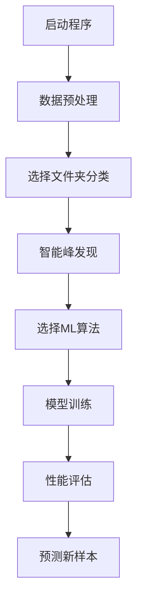

🔬 诊断分析工具 - 智能质谱数据分析系统
======================

📖 项目简介
-------

基于机器学习的质谱数据分析系统，专为疾病诊断设计。系统采用智能峰发现技术，自动提取最优特征，支持多种分类算法，提供端到端的数据分析解决方案。

**当前版本**: v1.8.6.4  
**最新更新**: 2025年8月29日
🌟 核心特性
-------

### 🧠 智能分析

* **智能峰发现**: 集成 pyOpenMS 专业质谱分析库，自动发现最优特征峰
* **ML导向算法**: 基于机器学习友好性评分的共识峰选择
* **动态归一化**: 全局扫描自动确定归一化因子

### 🎯 分类预测

* **多算法支持**: 随机森林、逻辑回归、神经网络、PLS回归等
* **智能预测**: 自动适配训练特征，支持任意类别名称
* **性能评估**: 混淆矩阵、ROC曲线、交叉验证等完整评估体系

### 🎨 用户界面

* **模块化设计**: 数据预处理、模型训练、结果展示、样本预测独立面板
* **实时进度**: 六步骤进度指示器，训练状态实时跟踪
* **统一图标**: 主窗口和子窗口图标一致性管理

### 🔄 灵活处理

* **文件夹分类**: 支持文件夹选择进行数据分类（推荐）
* **传统命名**: 兼容HC/LC文件命名规则
* **自定义类别**: 支持任意类别名称，不限于HC/LC

📁 项目架构
-------

    诊断分析工具/
    ├── src/             # 📦 模块化核心组件
    │   ├── main.py                # 🎮 程序入口和主界面管理器
    │   ├── data_processing.py     # 🔧 数据预处理模块
    │   ├── data_preprocessor.py   # 📂 文件分类对话框
    │   ├── model_training.py      # 🤖 模型训练引擎
    │   ├── model_predictor.py     # 🔮 样本预测模块
    │   ├── feature_detector.py    # 🎯 特征检测与处理
    │   ├── ui_components.py       # 🎨 UI组件库
    │   ├── visualization.py       # 📊 图表生成模块
    │   ├── help_system.py         # ❓ 帮助系统和向导
    │   ├── config.py              # ⚙️ 配置管理
    │   ├── data_store.py          # 💾 数据存储管理
    │   ├── utils.py               # 🛠️ 工具函数库
    │   └── output_manager.py      # 📤 输出文件管理
    ├── requirements.txt           # 📋 依赖包列表
    └── README.md                  # 📚 使用说明

🛠️ 环境配置
--------

### 系统要求

* **Python版本**: 3.8 或更高版本
* **操作系统**: Windows / macOS / Linux
* **内存**: 建议 4GB 以上（大数据集处理）

### 依赖安装

    # 安装所有依赖包
    pip install -r requirements.txt

### 核心依赖

    numpy >= 1.21.0          # 数值计算
    pandas >= 1.3.0          # 数据处理
    scikit-learn >= 1.0.0    # 机器学习算法
    matplotlib >= 3.5.0      # 图表绘制
    customtkinter >= 5.0.0   # 现代GUI界面
    pyopenms >= 3.0.0        # 质谱数据专业处理
    joblib >= 1.1.0          # 模型序列化

🚀 快速开始
-------

### 启动程序

    python main.py

### 核心工作流程

📋 详细使用指南
---------

### 步骤1: 数据预处理 📂

**文件夹分类模式（推荐）**

1. 点击**数据预处理面板**的"选择数据文件夹"
2. 选择包含原始质谱数据的文件夹
3. 在分类对话框中为每个类别选择对应文件夹
4. 输入自定义类别名称（如"健康"、"患病"）
5. 确认分类，等待处理完成

**传统命名模式**

* 文件名以类别标识开头（如 `HC001.txt`, `LC002.txt`）
* 直接选择包含所有文件的文件夹进行处理

### 步骤2: 智能特征提取 🎯

**智能峰发现模式（默认）**

* 使用 pyOpenMS 自动发现质谱峰
* 应用ML导向共识峰算法筛选最优特征
* 自动选择50个最具区分性的特征

**关键参数**（config.py中可调）:
    MAX_FEATURES = 50           # 最大特征数量
    MIN_OCCURRENCE_RATE = 0.2   # 最小出现频率（20%）
    MIN_FOLD_CHANGE = 1.3       # 最小倍数变化（30%差异）

### 步骤3: 模型训练 🤖

1. 点击"选择归一化excel文件"，加载预处理结果
2. 从**模型选择**菜单选择算法：
   * `LogisticRegressionCV`: 小数据集首选
   * `RandomForestClassifier`: 大数据集推荐
   * `PLSRegression`: 高维数据专用
   * `MLPClassifier`: 复杂模式识别
3. 点击"开始分析"启动训练（500轮交叉验证）

### 步骤4: 性能评估 📊

训练完成后自动生成：

* **准确率统计**: 平均准确率和标准偏差
* **混淆矩阵**: 分类结果详细展示
* **ROC曲线**: AUC值和诊断能力评估
* **特征重要性**: 关键m/z值贡献分析

### 步骤5: 样本预测 🔮

1. 点击"选择要检测的txt文件"
2. 选择未知样本文件
3. 系统自动匹配训练特征并给出预测结果
4. 查看分类结果和置信度评估

### 步骤6: 结果导出 📄

* **报告生成**: 支持病人信息录入和诊断报告打印
* **结果保存**: 自动保存所有训练结果和图表文件
* **批量预测**: 支持多个样本的批量分析

📊 输出文件结构
---------

    outputs/
    ├── data/                      # 📁 数据文件
    │   ├── normalized_ms_data.csv # 归一化特征矩阵
    │   └── intelligent_normalization_factor.txt # 动态归一化因子
    ├── models/                    # 🤖 模型文件
    │   └── best_model.joblib      # 最优训练模型
    ├── results/                   # 📈 训练结果
    │   ├── Con_matrix_SVM.csv     # 混淆矩阵统计
    │   ├── Fscore_SVM.csv         # F1分数统计
    │   ├── 2C_auc_SVM.csv         # AUC值统计
    │   └── PLS_optimal_thresholds.csv # PLS最优阈值
    └── charts/                    # 📊 评估图表
        ├── Training and Test Balanced Accuracy.png
        ├── Weighted Average Precision, Recall, and F1-score.png
        ├── Mean Confusion Matrix.png
        ├── Mean ROC Curve.png
        └── PLS_optimal_thresholds.png

⚙️ 高级配置
-------

### 智能峰发现参数调整

编辑 `config.py` 文件中的关键参数：
    # 特征选择控制
    MAX_FEATURES = 50              # 最大特征数量（30-100）
    MIN_OCCURRENCE_RATE = 0.2      # 最小出现频率（0.15-0.3）
    MIN_FOLD_CHANGE = 1.3          # 最小倍数变化（1.2-1.5）

    # 峰检测参数
    SIGNAL_TO_NOISE = 1.0          # 信噪比阈值
    SPACING_DIFFERENCE = 1.5       # 峰间距要求
    MZ_TOLERANCE = 0.2             # m/z匹配容差

### 推荐参数配置

| 研究类型    | MAX_FEATURES | MIN_OCCURRENCE_RATE | MIN_FOLD_CHANGE | 适用场景      |
| ------- | ------------ | ------------------- | --------------- | --------- |
| **保守型** | 30           | 0.3                 | 1.5             | 小样本、高精度要求 |
| **标准型** | 50           | 0.2                 | 1.3             | 一般研究、平衡性能 |
| **探索型** | 100          | 0.15                | 1.2             | 大样本、特征发现  |

🎯 算法选择指南
---------

### 推荐算法对比

| 算法                         | 适用数据量 | 训练速度 | 解释性 | 精度  | 推荐场景         |
| -------------------------- | ----- | ---- | --- | --- | ------------ |
| **LogisticRegressionCV**   | 小-中   | 快    | 高   | 中-高 | 临床验证、特征重要性分析 |
| **RandomForestClassifier** | 中-大   | 中    | 中   | 高   | 大规模筛查、稳定性优先  |
| **PLSRegression**          | 小-中   | 快    | 中   | 中-高 | 质谱数据首选、高维数据  |
| **MLPClassifier**          | 大     | 慢    | 低   | 高   | 复杂模式识别、非线性关系 |

### 选择建议

* **首次使用**: 推荐 `PLSRegression`（专为质谱数据优化）
* **小数据集** (<100样本): `LogisticRegressionCV`
* **大数据集** (>500样本): `RandomForestClassifier`
* **追求精度**: `MLPClassifier`（需要大样本）

🛠️ 故障排除
--------

### 常见问题解决

#### 安装问题

**问题**: pyOpenMS安装失败  
**解决**:
    # Windows
    conda install -c conda-forge pyopenms

    # macOS/Linux  
    pip install pyopenms

**问题**: CustomTkinter界面异常  
**解决**: 确保Python版本3.8+，更新所有依赖包

#### 数据处理问题

**问题**: "未发现任何有效峰"  
**解决**:

* 检查输入文件格式（两列：m/z值和强度）
* 降低`SIGNAL_TO_NOISE`参数值
* 确保数据不全为零

**问题**: "未识别出共识特征峰"  
**解决**:

* 降低`MIN_OCCURRENCE_RATE`和`MIN_FOLD_CHANGE`参数
* 增加样本数量确保足够的类别覆盖
* 检查两类样本是否有明显差异

**问题**: "特征值不匹配的bug"  
**解决**: 重新完整执行"数据预处理→模型训练→样本预测"流程

#### 性能问题

**问题**: 训练过程界面冻结  
**说明**: 正常现象，500轮交叉验证需要1-3分钟 **建议**: 耐心等待或选择更快的算法

**问题**: 内存不足  
**解决**:

* 关闭其他程序释放内存
* 减少`MAX_FEATURES`和`TRAINING_ITERATIONS`参数
* 处理更小的数据集

🔄 版本更新历史
---------

### v1.8.6.4 (当前版本)

* 修复子窗口图标显示问题
* 完善UI模块化架构
* 统一图标管理系统

### v1.8.1 (重要更新)

* UI面板集成，4列布局优化
* 数据预处理面板独立化
* 修复布局重叠问题

### v1.7.0 (架构重构)

* 模块化重构，代码拆分为多个专门模块
* 修复硬编码路径bug
* 统一类别映射管理

### v1.6.0 (文件夹分类)

* 文件夹选择替代文件命名规则
* 支持任意类别名称
* 实时预览分类结果

### v1.5.0 (智能峰发现)

* 集成pyOpenMS专业质谱分析
* ML导向共识峰算法
* 动态归一化系统

🔧 开发者信息
--------

### 代码架构

    # 主要模块关系
    MainGUIManager -> 协调所有组件
    ├── DataPreprocessor -> 数据预处理和文件分类
    ├── TrainingUI -> 模型训练界面逻辑  
    ├── PredictionManager -> 样本预测和模型信息
    ├── HelpSystem -> 帮助系统和进度跟踪
    └── UI Components -> 模块化界面组件
        ├── ControlPanel -> 操作控制面板
        ├── ResultPanel -> 训练结果显示
        ├── PredictionPanel -> 预测结果面板
        ├── VisualizationPanel -> 图表显示面板
        └── InfoPanel -> 运行日志面板

### 关键技术特性

* **模块化设计**: 功能拆分，易于维护扩展
* **数据持久化**: data_store模块统一管理运行时数据
* **错误处理**: 装饰器模式统一异常处理
* **界面组件化**: BasePanel基础类提供通用功能
* **进度跟踪**: 六步骤指示器引导用户操作

💡 使用技巧
-------

### 数据准备建议

1. **文件命名**: 使用有意义的文件名便于分类识别
2. **数据质量**: 确保原始质谱数据信噪比良好
3. **样本平衡**: 尽量保持两类样本数量接近

### 参数调优策略

1. **起始参数**: 使用默认配置进行首次分析
2. **性能优化**: 根据结果调整特征数量和阈值
3. **交叉验证**: 多次运行验证结果稳定性

### 工作流程优化

1. **批量处理**: 一次处理多个同类样本提高效率
2. **结果备份**: 重要结果及时导出备份
3. **模型复用**: 训练好的模型可以重复用于预测

📞 技术支持
-------

### 获取帮助

* **内置帮助**: 程序内"使用向导"详细指导
* **悬停提示**: 界面元素悬停显示操作说明
* **日志系统**: 运行信息面板实时显示操作状态

### 报告问题

如遇到技术问题，请记录：

1. 错误消息的完整文本
2. 操作步骤和输入文件
3. 系统环境（Python版本、操作系统）
4. 程序日志中的相关信息

* * *
