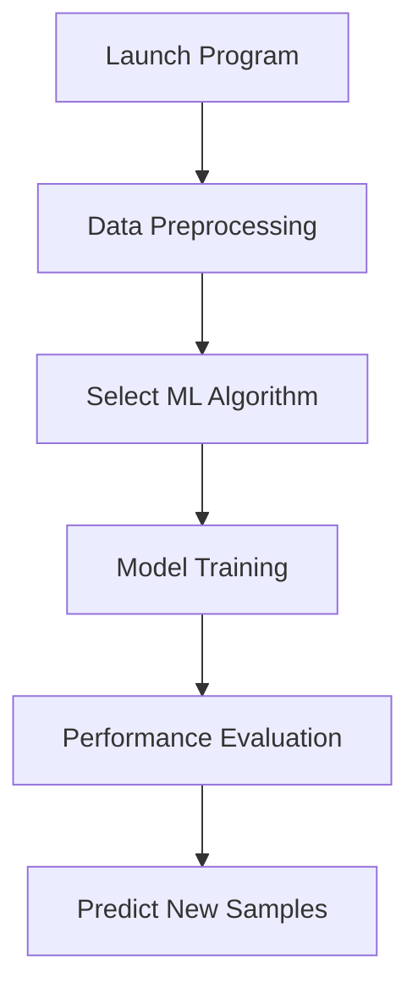

🔬 Diagnostic Analysis Tool - Intelligent Mass Spectrometry Data Analysis System
================================================================================

📖 Project Overview
-------------------

A machine learning-based mass spectrometry data analysis system designed for disease diagnosis. The system uses intelligent peak discovery technology to automatically extract optimal features, supports multiple classification algorithms, and provides end-to-end data analysis solutions.

**Current Version**: v1.8.6.4  
**Last Updated**: August 29, 2025
🌟 Core Features
----------------

### 🧠 Intelligent Analysis

* **Smart Peak Discovery**: Integrated pyOpenMS professional mass spectrometry analysis library for automatic optimal feature peak discovery
* **ML-Oriented Algorithm**: Consensus peak selection based on machine learning friendliness scoring
* **Dynamic Normalization**: Global scanning to automatically determine normalization factors

### 🎯 Classification Prediction

* **Multi-Algorithm Support**: Random Forest, Logistic Regression, Neural Networks, PLS Regression, etc.
* **Smart Prediction**: Automatic adaptation to training features, supports arbitrary category names
* **Performance Evaluation**: Complete evaluation system including confusion matrix, ROC curves, cross-validation

### 🎨 User Interface

* **Modular Design**: Independent panels for data preprocessing, model training, result display, and sample prediction
* **Real-time Progress**: Six-step progress indicator with real-time training status tracking
* **Unified Icons**: Consistent icon management for main and sub-windows

### 🔄 Flexible Processing

* **Folder Classification**: Support folder selection for data classification (recommended)
* **Traditional Naming**: Compatible with HC/LC file naming conventions
* **Custom Categories**: Support arbitrary category names, not limited to HC/LC

📁 Project Structure
--------------------

    Diagnostic Analysis Tool/
    ├── src/             # 📦 Modular core components
    │   ├── main.py                # 🎮 Program entry and main interface manager
    │   ├── data_processing.py     # 🔧 Data preprocessing module
    │   ├── data_preprocessor.py   # 📂 File classification dialog
    │   ├── model_training.py      # 🤖 Model training engine
    │   ├── model_predictor.py     # 🔮 Sample prediction module
    │   ├── feature_detector.py    # 🎯 Feature detection and processing
    │   ├── ui_components.py       # 🎨 UI component library
    │   ├── visualization.py       # 📊 Chart generation module
    │   ├── help_system.py         # ❓ Help system and wizard
    │   ├── config.py              # ⚙️ Configuration management
    │   ├── data_store.py          # 💾 Data storage management
    │   ├── utils.py               # 🛠️ Utility functions library
    │   └── output_manager.py      # 📤 Output file management
    ├── requirements.txt           # 📋 Dependencies list
    └── README.md                  # 📚 Usage documentation

🛠️ Environment Setup
---------------------

### System Requirements

* **Python Version**: 3.8 or higher
* **Operating System**: Windows / macOS / Linux
* **Memory**: Recommended 4GB+ (for large dataset processing)

### Dependencies Installation

    # Install all dependencies
    pip install -r requirements.txt

### Core Dependencies

    numpy >= 1.21.0          # Numerical computation
    pandas >= 1.3.0          # Data processing
    scikit-learn >= 1.0.0    # Machine learning algorithms
    matplotlib >= 3.5.0      # Chart plotting
    customtkinter >= 5.0.0   # Modern GUI interface
    pyopenms >= 3.0.0        # Mass spectrometry data professional processing
    joblib >= 1.1.0          # Model serialization

🚀 Quick Start
--------------

### Launch Program

    python main.py

### Core Workflow

📋 Detailed Usage Guide
-----------------------

### Step 1: Data Preprocessing 📂

**Folder Classification Mode (Recommended)**

1. Click "Select Data Folder" in the **Data Preprocessing Panel**
2. Choose folder containing raw mass spectrometry data
3. Select corresponding folders for each category in the classification dialog
4. Enter custom category names (e.g., "Healthy", "Disease")
5. Confirm classification and wait for processing completion

**Traditional Naming Mode**

* File names start with category identifiers (e.g., `HC001.txt`, `LC002.txt`)
* Directly select folder containing all files for processing

### Step 2: Smart Feature Extraction 🎯

**Smart Peak Discovery Mode (Default)**

* Uses pyOpenMS to automatically discover mass spectrometry peaks
* Applies ML-oriented consensus peak algorithm to filter optimal features
* Automatically selects 50 most discriminative features

**Key Parameters** (adjustable in config.py):
    MAX_FEATURES = 50           # Maximum number of features
    MIN_OCCURRENCE_RATE = 0.2   # Minimum occurrence frequency (20%)
    MIN_FOLD_CHANGE = 1.3       # Minimum fold change (30% difference)

### Step 3: Model Training 🤖

1. Click "Select Normalized Excel File" to load preprocessing results
2. Choose algorithm from **Model Selection** menu:
   * `LogisticRegressionCV`: First choice for small datasets
   * `RandomForestClassifier`: Recommended for large datasets
   * `PLSRegression`: Specialized for high-dimensional data
   * `MLPClassifier`: For complex pattern recognition
3. Click "Start Analysis" to begin training (500 cross-validation rounds)

### Step 4: Performance Evaluation 📊

Automatically generates after training completion:

* **Accuracy Statistics**: Mean accuracy and standard deviation
* **Confusion Matrix**: Detailed classification results display
* **ROC Curves**: AUC values and diagnostic capability assessment
* **Feature Importance**: Key m/z value contribution analysis

### Step 5: Sample Prediction 🔮

1. Click "Select txt File to Detect"
2. Choose unknown sample files
3. System automatically matches training features and provides prediction results
4. View classification results and confidence assessment

### Step 6: Results Export 📄

* **Report Generation**: Support patient information entry and diagnostic report printing
* **Results Saving**: Automatically save all training results and chart files
* **Batch Prediction**: Support batch analysis of multiple samples

🔧 Advanced Features
--------------------

### Intelligent Peak Discovery Technology

* **Professional Library**: Based on pyOpenMS, the industry standard for mass spectrometry analysis
* **Automatic Feature Selection**: No need for manual m/z value presetting
* **ML-Friendly Algorithm**: Optimizes features specifically for machine learning performance

### Dynamic Normalization System

* **Global Scanning**: Two-round processing, first scan for global maximum intensity values
* **Scientific Normalization**: Uses actual data maximum values as normalization factors
* **Factor Preservation**: Automatically saves normalization information to ensure prediction consistency

### Smart Prediction Adaptation

* **Automatic Detection**: Automatically recognizes training methods and features during prediction
* **Feature Matching**: Automatically extracts feature m/z values from training data CSV
* **Normalization Sync**: Processes prediction samples using the same normalization factors as training

⚠️ Important Notes
------------------

### Current Limitations

1. **Isotope Processing**: Peak extraction section has not yet implemented isotope processing, currently using the simplest implementation
2. **Workflow Dependency**: Must complete the entire "Peak Mode Selection → Model Training" workflow before predicting unknown samples, otherwise feature value mismatch bugs will occur
3. **Interface Blocking**: During training, the entire GUI interface is frozen and cannot be operated (training takes 1-3 minutes)
4. **Normalization Factor**: External CSV files (already normalized) cannot correctly infer original normalization factors

### Known Issues

* **UI Component Reset**: Due to initial design flaws, entire panels need to be recreated during reset
* **Visualization Panel**: Uses "replacement" rather than "update" mode for display

📈 Performance Expectations
---------------------------

### Typical Processing Times

* **Data Preprocessing**: 30 seconds - 2 minutes (depends on file count)
* **Model Training**: 1-3 minutes (500 rounds cross-validation)
* **Sample Prediction**: 1-5 seconds per sample
* **Chart Generation**: 10-30 seconds

### Resource Requirements

* **CPU**: Multi-core recommended for training acceleration
* **Memory**: 2-8GB depending on dataset size
* **Storage**: 100MB-1GB for results and models

🔄 Migration and Compatibility
------------------------------

### Backward Compatibility

* ✅ All original functions work normally
* ✅ User operation flow unchanged
* ✅ Launch method unchanged: `python main.py`
* ✅ Configuration file format unchanged

### Version Migration

* **From v1.5 and earlier**: Automatic migration, no manual intervention required
* **Configuration Files**: Automatically preserved and upgraded
* **Data Files**: Full compatibility, existing processed data can be directly used

📄 License
----------

This project is for research and educational purposes. Please cite appropriately if used in academic work.
🤝 Contributing
---------------

Contributions are welcome! Please feel free to submit issues and enhancement requests.
📞 Support
----------

For questions and support, please refer to the built-in help system or contact the development team.

* * *

_This tool represents the latest advancement in automated mass spectrometry analysis, combining professional-grade algorithms with user-friendly interfaces to democratize access to sophisticated analytical capabilities._